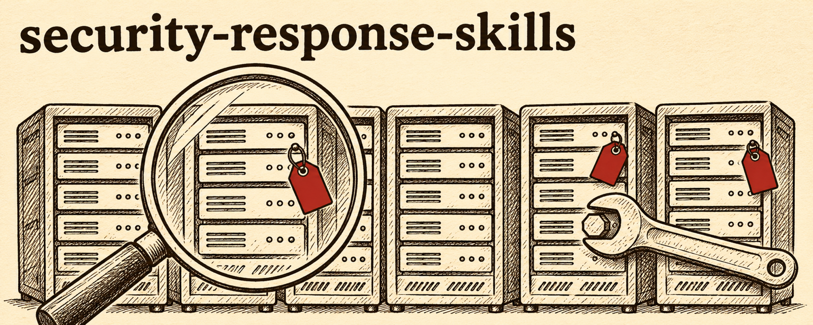

<p align="center">
  
</p>

<p align="center">
  <a href="README.md">English</a> · <b>한국어</b>
</p>

# security-response-skills

**긴급 보안 공지가 나오면 어떤 서버가 영향받는지 몇 초 만에 확인하고, 대응이 필요한 것만 런북대로 처리합니다.**

## 무엇인가

Claude Code와 Codex용 에이전트 스킬 모음입니다. 스킬 하나가 보안 이슈 하나를 맡습니다. 호스트와 컨테이너를 읽기 전용으로 빠르게 점검하고, 대응이 필요한 항목만 추린 뒤, 항목마다 정해진 방법으로 조치하고 다시 점검합니다.

## 왜 만들었나

NGINX2Root, Java4Shell 같은 공지는 분량이 많습니다. 영향 버전, CPU 조건, 설정 조건, 배포판 백포트, 임시 완화책까지 서버가 노출된 상태에서 다 읽고 판단하기엔 느립니다. 서비스가 실제로 쓰는 JDK가 아니라 `PATH`의 JDK를 올리거나, 임시 완화에서 멈추는 실수도 잦습니다. 그래서 공지 하나를 점검 스크립트 하나와 런북 묶음으로 바꿔 둡니다.

## 스킬 목록

| 스킬 | 대상 | 점검 항목 |
|---|---|---|
| [`nginx2root-java4shell`](skills/nginx2root-java4shell/SKILL.md) | NGINX2Root (CVE-2026-123007, -123633, -121810, -123634, -113425), Java4Shell (CVE-2026-114938), Linux SCTP 권한 상승 | nginx 버전과 배포판 백포트, HTTP/2, HTTP/3, resolver, 메일 프록시, 업그레이드 후 재시작 누락, 크래시 로그 / 실행 중인 JVM별 버전, AVX-512 VBMI CPU 조건, `-XX:-UseBASE64Intrinsics` / SCTP 모듈 상태 |

스킬은 계속 추가됩니다.

## 모든 스킬의 동작 방식

1. **점검**: `scripts/check.sh`가 항목마다 한 줄씩 출력합니다. `STATUS  ACTION_ID  TARGET  DETAIL`
2. **선별**: `ACTION`(조치 필요), `MITIGATE`(패치 전 임시 완화), `REVIEW`(직접 확인 필요)만 남깁니다.
3. **대응**: `ACTION_ID`마다 `references/remediation.md`에 절차, 확인 방법, 롤백이 있습니다. 패치가 먼저이고, 완화책은 패치를 바로 못 할 때만 씁니다.
4. **확인**: 다시 점검합니다. `ACTION`이 하나도 안 남으면 끝입니다.

## 예시

nginx 컨테이너 3개와 JVM 1개가 떠 있는 Docker 호스트(ARM VM)에서 root로 실행한 결과입니다. 이 스킬을 만들며 돌린 테스트 출력입니다.

```text
$ sudo bash check.sh
# nginx2root-java4shell check v1.0.0 host=colima os=Linux arch=aarch64 date=2026-11-20T01:54:56Z root=yes
STATUS	ID	TARGET	DETAIL
INFO	CPU	colima	arch=aarch64 (ARM, Java4Shell path not reachable)
INFO	NGX-PATCH	colima	no nginx binary found on host
INFO	JAVA-PATCH	colima	no Java runtime found on host (outside containers)
ACTION	NGX-PATCH	colima:docker:t-nginx-old (nginx:1.24-alpine)	nginx 1.24.0 is in the affected range and no backported fix was found
MITIGATE	NGX-H2-OFF	colima:docker:t-nginx-old (nginx:1.24-alpine)	HTTP/2 enabled (CVE-2026-123007, CVE-2026-123633)
MITIGATE	NGX-RESOLVER	colima:docker:t-nginx-old (nginx:1.24-alpine)	resolver with mirror/SSI subrequests or a variable proxy_pass (CVE-2026-123634)
OK	NGX-PATCH	colima:docker:t-ubuntu (ubuntu:24.04)	nginx 1.24.0, distro package changelog lists CVE-2026-123007 (backported fix)
INFO	JAVA-PATCH	colima:docker:t-java (eclipse-temurin:21-jdk)	Java 21.0.13 below fixed 21.0.13.1, but arch=aarch64 (ARM, Java4Shell path not reachable); patch on the normal cycle and recheck if the VM moves to another CPU type
OK	NGX-PATCH	colima:docker:t-nginx-alpine (nginx:alpine)	nginx 1.31.9 >= 1.31.9 (mainline fix)
ACTION	KRN-SCTP	colima:kernel 6.8.0-117-generic	sctp module can be autoloaded; block it unless SCTP is in use
# summary host=colima ACTION=2 MITIGATE=2 REVIEW=0 OK=2 INFO=4
```

에이전트는 이후 `ACTION`과 `MITIGATE` 줄만 처리합니다.

## 요구 사항

- 점검 대상: bash가 있는 Linux (macOS는 버전 점검만). root면 전부 볼 수 있고, 아니면 못 본 부분을 `REVIEW`로 알려 줍니다.
- 대상에 있으면 쓰는 도구: `docker`, `nsenter`, `kubectl`, `openssl`, `curl`
- 스킬을 읽는 에이전트: Claude Code 또는 Codex

## 설치

Claude Code 플러그인:

```bash
claude plugin marketplace add nathankim0/security-response-skills
claude plugin install security-response@security-response-skills
```

또는 클론해서 스킬 폴더를 링크합니다. Claude Code와 Codex 모두 되고, `git pull`로 갱신됩니다.

```bash
git clone https://github.com/nathankim0/security-response-skills.git
cd security-response-skills
./install.sh            # 둘 다. 하나만: ./install.sh claude | ./install.sh codex
```

## 사용법

에이전트에게 평소 말투로 요청하면 됩니다. 예: "NGINX2Root랑 Java4Shell 점검해줘", "web1 web2 api1 nginx HTTP/2 RCE 점검해". 스킬이 대상을 정하고, 점검하고, 선별 표를 보여 주고, 운영 시스템을 바꾸기 전에 확인을 받습니다.

점검 스크립트만 따로 실행해도 됩니다.

```bash
sudo bash skills/nginx2root-java4shell/scripts/check.sh
ssh web1 'sudo -n bash -s' < skills/nginx2root-java4shell/scripts/check.sh
bash skills/nginx2root-java4shell/scripts/check.sh --k8s --probe example.com
```

`ACTION`이나 `MITIGATE`가 하나라도 있으면 종료 코드가 1이라 CI나 cron에도 넣을 수 있습니다.

## 저장소 구조

```text
.claude-plugin/                  플러그인, 마켓플레이스 매니페스트
skills/<name>/SKILL.md           스킬 본문: 범위, 점검, 선별, 대응, 확인
skills/<name>/scripts/check.sh   읽기 전용 점검 스크립트
skills/<name>/references/        조치 런북, 공지 요약, 침해 점검
tests/run.sh                     가짜 바이너리로 점검 스크립트 테스트
install.sh                       Claude Code, Codex에 스킬 링크
AGENTS.md                        에이전트 규칙, 스킬 추가 방법
```

## 스킬 추가하기

[AGENTS.md](AGENTS.md)의 "Adding a skill"을 따릅니다. 이슈 하나에 폴더 하나, 공통 출력 형식을 지키는 읽기 전용 `check.sh`, 조치 ID마다 런북 한 섹션.

## 라이선스

MIT
