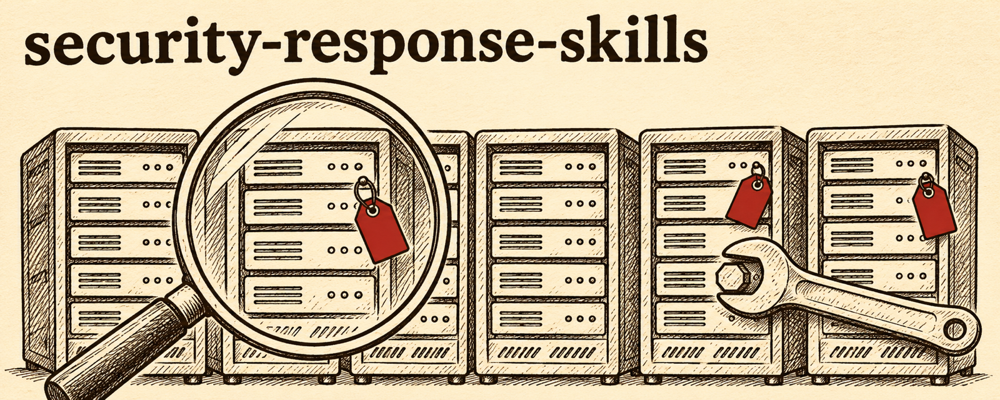

<p align="center">
  
</p>

<p align="center">
  <b>English</b> · <a href="README.ko.md">한국어</a>
</p>

# security-response-skills

**When a critical advisory drops, find out in seconds which of your servers are affected, then fix only those, one runbook at a time.**

## What it is

A collection of agent skills for Claude Code and Codex. Each skill covers one security issue. It runs a read-only check across hosts and containers, keeps only the findings that need a response, and walks the agent through the fix for each one, then checks again.

## Why it exists

Advisories like NGINX2Root and Java4Shell come with long write-ups: version ranges, CPU conditions, config conditions, backported distro packages, temporary mitigations. Reading all of that while servers are exposed is slow, and it is easy to patch the wrong thing (the JDK on `PATH` instead of the one the service runs) or stop at a mitigation. These skills turn each advisory into a check script and a set of runbooks.

## Skills

| Skill | Covers | Checks |
|---|---|---|
| [`nginx2root-java4shell`](skills/nginx2root-java4shell/SKILL.md) | NGINX2Root (CVE-2026-123007, -123633, -121810, -123634, -113425), Java4Shell (CVE-2026-114938), Linux SCTP privilege escalation | nginx version and distro backport, HTTP/2, HTTP/3, resolver, mail proxy, stale binary after upgrade, crash logs; JVM version per running process, AVX-512 VBMI CPU gate, `-XX:-UseBASE64Intrinsics`; SCTP module state |

More skills will be added here.

## How every skill works

1. **Check**: `scripts/check.sh` prints one line per finding: `STATUS  ACTION_ID  TARGET  DETAIL`.
2. **Triage**: only `ACTION` (fix needed), `MITIGATE` (temporary measure while the fix waits) and `REVIEW` (confirm by hand) rows are kept.
3. **Respond**: each `ACTION_ID` has a section in `references/remediation.md` with steps, verification and rollback. Patches come first; mitigations only when the patch has to wait.
4. **Verify**: the check runs again. Done when no `ACTION` row is left.

## Example

`check.sh` run as root on a Docker host (ARM VM) with three nginx containers and one JVM, from the test run while building this skill:

```text
$ sudo bash check.sh
# nginx2root-java4shell check v1.0.0 host=colima os=Linux arch=aarch64 date=2026-11-20T01:54:56Z root=yes
STATUS	ID	TARGET	DETAIL
INFO	CPU	colima	arch=aarch64 (ARM, Java4Shell path not reachable)
INFO	NGX-PATCH	colima	no nginx binary found on host
INFO	JAVA-PATCH	colima	no Java runtime found on host (outside containers)
ACTION	NGX-PATCH	colima:docker:t-nginx-old (nginx:1.24-alpine)	nginx 1.24.0 is in the affected range and no backported fix was found
MITIGATE	NGX-H2-OFF	colima:docker:t-nginx-old (nginx:1.24-alpine)	HTTP/2 enabled (CVE-2026-123007, CVE-2026-123633)
MITIGATE	NGX-RESOLVER	colima:docker:t-nginx-old (nginx:1.24-alpine)	resolver with mirror/SSI subrequests or a variable proxy_pass (CVE-2026-123634)
OK	NGX-PATCH	colima:docker:t-ubuntu (ubuntu:24.04)	nginx 1.24.0, distro package changelog lists CVE-2026-123007 (backported fix)
INFO	JAVA-PATCH	colima:docker:t-java (eclipse-temurin:21-jdk)	Java 21.0.13 below fixed 21.0.13.1, but arch=aarch64 (ARM, Java4Shell path not reachable); patch on the normal cycle and recheck if the VM moves to another CPU type
OK	NGX-PATCH	colima:docker:t-nginx-alpine (nginx:alpine)	nginx 1.31.9 >= 1.31.9 (mainline fix)
ACTION	KRN-SCTP	colima:kernel 6.8.0-117-generic	sctp module can be autoloaded; block it unless SCTP is in use
# summary host=colima ACTION=2 MITIGATE=2 REVIEW=0 OK=2 INFO=4
```

The agent then works only on the `ACTION` and `MITIGATE` rows.

## Requirements

- Targets: Linux with bash (macOS works for the version checks). Root gives full results; without it the script reports what it could not see.
- Optional on targets: `docker`, `nsenter`, `kubectl`, `openssl`, `curl`.
- An agent that loads skills: Claude Code or Codex.

## Install

Claude Code plugin:

```bash
claude plugin marketplace add nathankim0/security-response-skills
claude plugin install security-response@security-response-skills
```

Or clone and link the skill folders (Claude Code and Codex; `git pull` updates them):

```bash
git clone https://github.com/nathankim0/security-response-skills.git
cd security-response-skills
./install.sh            # both; or: ./install.sh claude | ./install.sh codex
```

## Usage

Ask the agent in plain words, for example "NGINX2Root랑 Java4Shell 점검해줘" or "check web1 web2 api1 for the nginx HTTP/2 RCE". The skill picks the targets, runs the check, shows the triage table, and confirms before changing production.

The check script also runs on its own:

```bash
sudo bash skills/nginx2root-java4shell/scripts/check.sh
ssh web1 'sudo -n bash -s' < skills/nginx2root-java4shell/scripts/check.sh
bash skills/nginx2root-java4shell/scripts/check.sh --k8s --probe example.com
```

Exit code 1 means at least one `ACTION` or `MITIGATE` row, so it also works in CI or cron.

## Repository layout

```text
.claude-plugin/                  plugin and marketplace manifests
skills/<name>/SKILL.md           the skill: scope, check, triage, respond, verify
skills/<name>/scripts/check.sh   read-only check
skills/<name>/references/        remediation runbooks, advisory summary, compromise checks
tests/run.sh                     check script tests with fake binaries
install.sh                       links skills into Claude Code and Codex
AGENTS.md                        rules for agents, including how to add a skill
```

## Contributing a skill

Follow "Adding a skill" in [AGENTS.md](AGENTS.md): one folder per issue, a read-only `check.sh` that prints the shared finding format, and one runbook section per action id.

## License

MIT
